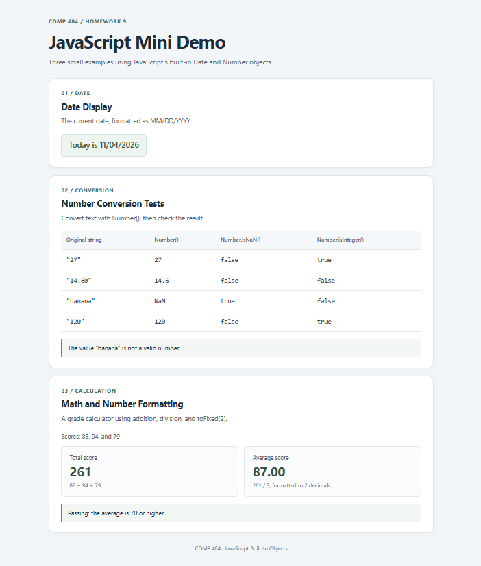

# Homework 9: JavaScript Built-In Objects

COMP 484 — JavaScript Mini Demo

This single-page demo displays today's date, converts four strings to numbers, and calculates a total and average for three scores. All results are displayed on the webpage by the external `script.js` file.

## GitHub Pages

[View Here](https://edaper.github.io/COMP484-HW9/)

## Files

- `index.html`: webpage structure and link to the external JavaScript file.
- `script.js`: date formatting, separate number conversions, arithmetic, and conditional messages.
- `style.css`: responsive styling with a separate card for each section.
- `screenshot.png`: screenshot of the finished webpage.
- `README.md`: project description, methods, live link, reflection, and sources.

## Built-in Objects and Methods Used

- `Date` and `new Date()`: get the current date when the webpage loads.
- `Date.prototype.getMonth()`: get the zero-based month; add 1 for the usual month number.
- `Date.prototype.getDate()`: get the day of the month.
- `Date.prototype.getFullYear()`: get the full year.
- `Number` and `Number()`: convert each original string into a number.
- `Number.isNaN()`: check whether each converted value is NaN.
- `Number.isInteger()`: check whether each converted value is an integer.
- `Number.prototype.toFixed(2)`: format the average with two decimal places.

Browser DOM features used: `document.getElementById()`, `textContent`, and `innerHTML`.

## Number Conversion Results

Each value is stored in its own variable and processed with separate statements. This section uses no arrays or loops.

| Original string | Converted result | Number.isNaN() | Number.isInteger() |
| --- | --- | --- | --- |
| `"27"` | `27` | `false` | `true` |
| `"14.60"` | `14.6` | `false` | `false` |
| `"banana"` | `NaN` | `true` | `false` |
| `"120"` | `120` | `false` | `true` |

## Math and Conditionals

The numeric scores are 88, 94, and 79. Addition produces a total of 261; division by 3 produces an average displayed as 87.00 using `toFixed(2)`.

One `if/else` chooses the number validation message. Another `if/else` chooses Passing or Not passing using an average threshold of 70. Two additional `if/else` statements add leading zeros to the month and day when needed.

## Screenshot

Path: `screenshot.png`

## Reflection

Working with the numeric variables was the easiest part. The hardest part was formatting the date with leading zeros. I learned that the Date object counts months starting at zero, so I added one to get the usual month number. I learned that Number() converts numeric strings and that Number.isNaN() and Number.isInteger() check the converted results. I also learned that JavaScript can display results in the browser by updating HTML elements with textContent and innerHTML.

## Extra Credit

Chosen option: light CSS styling that makes each section look like a separate card or panel.

## Sources and Assistance

- [MDN: Date.getMonth()](https://developer.mozilla.org/en-US/docs/Web/JavaScript/Reference/Global_Objects/Date/getMonth)
- [MDN: Number](https://developer.mozilla.org/en-US/docs/Web/JavaScript/Reference/Global_Objects/Number)
- ChatGPT assistance: interpreting the assignment, drafting example files, and explaining the implementation.

## Run Locally

Open `index.html` in a browser, or open it with VS Code's Live Server extension. No installation or build command is required for the webpage itself.
